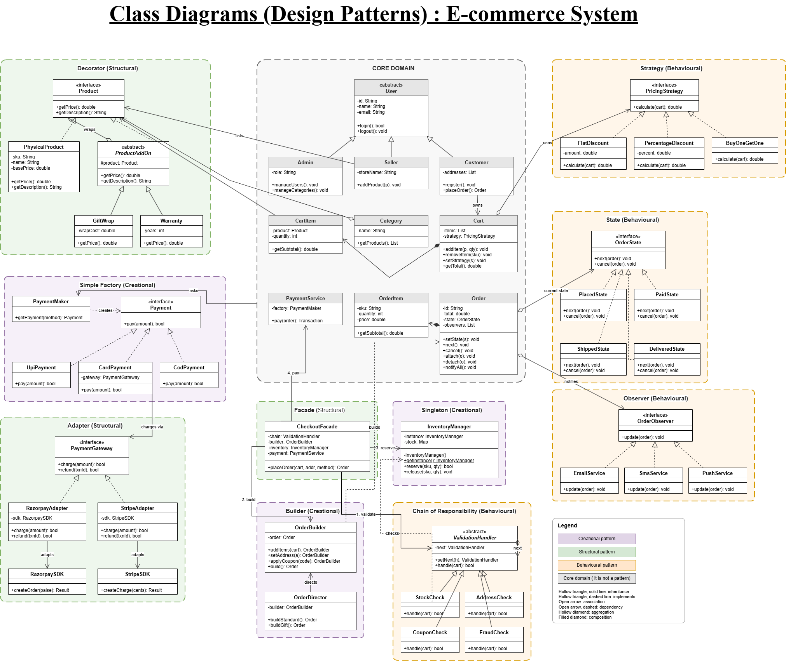

# E-Commerce Design Patterns

A working in-memory E-Commerce backend in Python (FastAPI) where one checkout call passes through seven design patterns. A console demo (`main.py`) and a REST API (`app.py`) show the full flow.

**Live URL:** https://ecommerce-patterns.onrender.com/docs

## Contents

1. [Checkout flow](#checkout-flow)
2. [Design patterns used](#design-patterns-used)
3. [Module-wise implementation](#module-wise-implementation)
4. [Testing](#testing)
5. [Project structure](#project-structure)
6. [How to run](#how-to-run)
7. [API endpoints](#api-endpoints)
8. [UML diagram](#uml-diagram)
9. [Team](#team)

## Checkout flow

Cart → (Strategy: discount) → total
`CheckoutFacade.place_order()`:
1. Validate: Stock → Address → Coupon → Fraud (Chain of Responsibility)
2. Reserve stock (Singleton)
3. Create the order (Builder)
4. Attach Email / SMS / Push observers (Observer)
5. Mock payment, order becomes Paid (State)

Order life cycle: Placed → Paid → Shipped → Delivered (cancel allowed only in Placed and Paid).

## Design patterns used

| Pattern | Type | Class(es) | File | Problem solved |
|---|---|---|---|---|
| Facade | Structural | CheckoutFacade | facade/checkout_facade.py | Hides the many checkout steps behind one `place_order()` call |
| Chain of Responsibility | Behavioural | ValidationHandler, StockCheck, AddressCheck, CouponCheck, FraudCheck | chain/handlers.py | Runs checks one by one, stops at the first failure, checks can be added or reordered |
| Singleton | Creational | InventoryManager | inventory/inventory_manager.py | One shared stock store for the whole app |
| Strategy | Behavioural | PricingStrategy, FlatDiscount, PercentageDiscount, BuyOneGetOne | pricing/strategies.py | Discount algorithms can be switched at runtime |
| Builder | Creational | OrderBuilder, OrderDirector | builder/order_builder.py | Builds an Order step by step; the Director holds ready-made recipes |
| State | Behavioural | OrderState, PlacedState, PaidState, ShippedState, DeliveredState, CancelledState | state/order_state.py | Order behaviour (next, cancel) depends on its current state |
| Observer | Behavioural | OrderObserver, EmailService, SmsService, PushService | observer/observers.py | Notifies services whenever the order state changes |

## Module-wise implementation

### Module A: Skeleton, domain, Facade and API (Janhavi Naik)

**Files:** `domain/`, `facade/checkout_facade.py`, `app.py`, `main.py`, `tests/test_facade.py`

- `domain/`: `Product`, `Category`, `CartItem`, `Cart`, `OrderItem`, `Order`, `CheckoutRequest` and the user classes (`User`, `Admin`, `Seller`, `Customer`). `Order` passes `next()` and `cancel()` to its current state, and `set_state()` always ends with `notify_all()`.
- `facade/checkout_facade.py`: `CheckoutFacade.place_order()` runs the whole checkout: validate, reserve stock, build the order, attach observers, mock payment, move to Paid.
- `app.py`: FastAPI endpoints (`/health`, `/checkout`, `/orders/{id}`, `/orders/{id}/next`, `/orders/{id}/cancel`), deployed on Render.
- `main.py`: console demo of the full flow.
- Tests: `tests/test_facade.py` (successful order, rejected order).

### Module B: Chain of Responsibility and Singleton (Disha Naik)

**Files:** `chain/handlers.py`, `inventory/inventory_manager.py`, `tests/test_chain_singleton.py`

**Chain of Responsibility.** A checkout request passes through validation handlers in this order:

`StockCheck → AddressCheck → CouponCheck → FraudCheck`

- **StockCheck:** checks that enough stock is available for every product in the cart.
- **AddressCheck:** validates the delivery address and checks for a six-digit PIN code.
- **CouponCheck:** checks that the coupon code is valid (`SAVE10`, `FLAT50`). No coupon is accepted.
- **FraudCheck:** rejects requests when the cart total exceeds ₹1,00,000.

If a validation fails, the chain stops and returns `False`. If all pass, it returns `True`.

**Singleton (Inventory Manager).** Only one `InventoryManager` instance exists and is shared across the application.

- `get_instance()`: returns the shared instance.
- `add_stock(sku, qty)`: adds stock for a product.
- `reserve(sku, qty)`: reserves stock if enough is available, otherwise returns `False`.
- `release(sku, qty)`: adds released stock back.

Thread locks protect both singleton creation and stock operations.

**Tests:** 4 tests cover the Singleton returning the same instance, successful and failed stock reservation, a valid request passing the chain, and an invalid coupon failing validation.

**Git:** branch `feature/chain-singleton`, pull request #1.

### Module C: Strategy and Builder (Karuna Gauns)

**Files:** `pricing/strategies.py`, `builder/order_builder.py`, `tests/test_strategy_builder.py`

**Strategy.** `PricingStrategy` is the base class with `calculate(cart)`. The discount can be switched at runtime with `cart.set_strategy()`.

- **FlatDiscount:** subtracts a fixed amount, never going below zero.
- **PercentageDiscount:** subtracts a percentage of the subtotal.
- **BuyOneGetOne:** one free item for every two units of the same product.

**Builder.**

- **OrderBuilder:** builds an order step by step with `add_items`, `set_address`, `apply_coupon` and `build()`. Each setter returns `self` so calls can be chained.
- **OrderDirector:** holds ready-made recipes: `build_standard()` and `build_gift()`.

**Tests:** 5 tests cover all three pricing strategies and the creation of standard and gift orders.

**Git:** branch `feature/strategy-builder`, pull request #3.

### Module D: State and Observer (Saini)

**Files:** `state/order_state.py`, `observer/observers.py`, `tests/test_state_observer.py`

**State.** An order behaves differently depending on its current state, so there are no big if/else chains. `Order` passes `next()` and `cancel()` to its current state object.

| State | next() | cancel() |
|---|---|---|
| PlacedState | moves to Paid | moves to Cancelled |
| PaidState | moves to Shipped | moves to Cancelled |
| ShippedState | moves to Delivered | blocked |
| DeliveredState | no next state | blocked |
| CancelledState | no next state | already cancelled |

Every state change goes through `order.set_state()`.

**Observer.** `order.set_state()` calls `notify_all()`, which calls `update(order)` on every attached observer.

| Observer | Output |
|---|---|
| EmailService | `[Email] Order <id> is now <state>` |
| SmsService | `[SMS] Order <id> is now <state>` |
| PushService | `[Push] Order <id> is now <state>` |

**Usage example:**

```python
from domain.order import Order
from state.order_state import PlacedState
from observer.observers import EmailService, SmsService, PushService

order = Order("ORD1", 100, state=PlacedState())
order.attach(EmailService())
order.attach(SmsService())
order.attach(PushService())

order.next()    # Paid, all three observers print
order.next()    # Shipped
order.cancel()  # blocked: already shipped
```

**Tests:** 6 tests cover the state flow, cancel rules, observer notifications and detaching an observer.

**Git:** branch `feature/state-observer`, pull request #2.

## Testing

| Test file | Tests | Covers |
|---|---|---|
| `tests/test_facade.py` | 2 | Full checkout flow and rejected order |
| `tests/test_chain_singleton.py` | 4 | Chain of Responsibility and Singleton |
| `tests/test_strategy_builder.py` | 5 | Pricing strategies and Builder |
| `tests/test_state_observer.py` | 6 | State transitions and Observer |

Run all tests from the project root:

```bash
pytest -q
```

Result: **17 passed**.

## Project structure

```
ecommerce-patterns/
├── app.py            FastAPI application
├── main.py           console demo
├── requirements.txt
├── domain/           User, Product, Cart, Order, CheckoutRequest
├── facade/           CheckoutFacade
├── chain/            validation handlers
├── inventory/        InventoryManager (Singleton)
├── pricing/          pricing strategies
├── builder/          OrderBuilder, OrderDirector
├── state/            order states
├── observer/         notification services
├── tests/            pytest tests
└── docs/             UML diagram
```

## How to run

```bash
pip install -r requirements.txt
python main.py            # console demo
pytest -q                 # all tests
uvicorn app:app --reload  # API, then open http://127.0.0.1:8000/docs
```

## API endpoints

| Endpoint | Purpose |
|---|---|
| GET /health | Check the service is running |
| POST /checkout | Place an order |
| GET /orders/{id} | View an order and its state |
| POST /orders/{id}/next | Move the order to the next state |
| POST /orders/{id}/cancel | Cancel (only in Placed or Paid) |
| GET /docs | Swagger page to test everything |

Example checkout request:

```json
{
  "items": [{"sku": "P1", "quantity": 2}],
  "address": "12 MG Road, Panaji, Goa 403001",
  "payment_method": "UPI",
  "strategy": "percentage",
  "coupon_code": "SAVE10"
}
```

## UML diagram



## Team

| Member | Module |
|---|---|
| Janhavi Naik | Module A: Skeleton, domain, Facade, API, deployment |
| Disha Naik | Module B: Chain of Responsibility, Singleton |
| Karuna Gauns | Module C: Strategy, Builder |
| Saini | Module D: State, Observer |